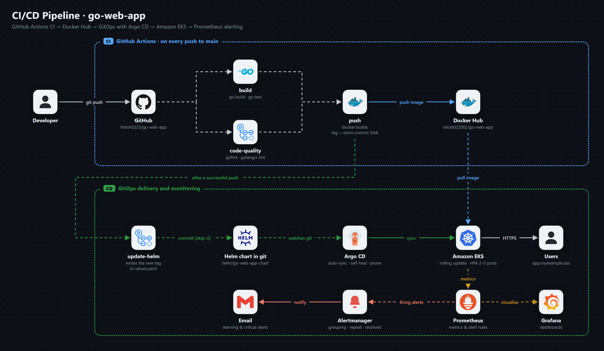
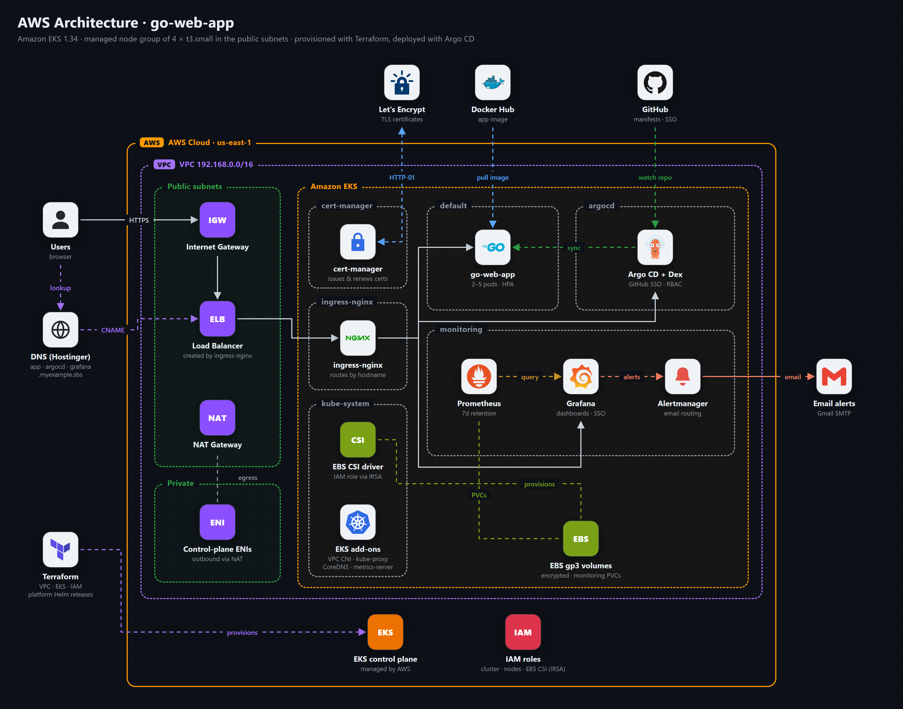

# Go Web App on AWS EKS: CI/CD, GitOps and Observability

An end-to-end DevOps project that takes a Go web application from a `git push` to a production-style
Kubernetes deployment on AWS. Every change is tested, linted, packaged as a container image and
rolled out by Argo CD, behind HTTPS, with metrics, dashboards and email alerting, and with the
underlying AWS infrastructure described in Terraform.

| | |
|---|---|
| **Live app** | https://app.myexample.sbs/home |
| **Argo CD** | https://argocd.myexample.sbs (GitHub login) |
| **Grafana** | https://grafana.myexample.sbs (GitHub login) |
| **Container image** | [`nitish022002/go-web-app`](https://hub.docker.com/r/nitish022002/go-web-app) on Docker Hub |


## Highlights

- **CI with GitHub Actions**: build, unit tests, `gofmt` and `golangci-lint` on every push to `main`.
- **Immutable images**: each build is pushed to Docker Hub tagged with the commit's short SHA.
- **GitOps CD with Argo CD**: CI commits the new image tag to the Helm chart; Argo CD syncs it to the cluster, with self-healing and pruning.
- **Kubernetes on AWS EKS**: managed node group, autoscaling (HPA), EBS-backed persistent volumes.
- **HTTPS everywhere**: ingress-nginx with free Let's Encrypt certificates issued and renewed by cert-manager.
- **Single sign-on**: GitHub login for Argo CD (Dex) and Grafana, restricted to the project owner.
- **Observability**: Prometheus, Grafana dashboards and Alertmanager sending email alerts through Gmail.
- **Infrastructure as Code**: Terraform modules for the VPC, EKS cluster, IAM and platform components.
- **No secrets in git**: credentials live only in GitHub environment secrets and Kubernetes Secrets.

## Tech stack

| Area | Tools |
|---|---|
| Application | Go 1.22 (`net/http`), HTML/CSS |
| Container | Docker multi-stage build, distroless runtime image |
| CI | GitHub Actions, golangci-lint, Docker Buildx, Docker Hub |
| Packaging | Helm |
| CD / GitOps | Argo CD (app-of-apps), Dex with GitHub OAuth |
| Kubernetes | AWS EKS 1.34, managed node group, HPA, metrics-server |
| Networking and TLS | ingress-nginx (AWS load balancer), cert-manager, Let's Encrypt |
| Storage | Amazon EBS CSI driver, gp3 volumes |
| Monitoring | Prometheus, Grafana, Alertmanager, node-exporter, kube-state-metrics (kube-prometheus-stack) |
| Infrastructure as Code | Terraform (AWS, Helm and Kubernetes providers) |

## CI/CD pipeline



1. A push to `main` starts the workflow in [`.github/workflows/ci.yaml`](.github/workflows/ci.yaml).
2. **build** and **code-quality** run in parallel: `go build`, `go test`, a `gofmt` check and `golangci-lint`.
3. **push** builds the image with Docker Buildx and pushes `nitish022002/go-web-app:<short-sha>`. Docker Hub credentials come from the `production` GitHub environment.
4. **update-helm** writes that tag into [`helm/go-web-app-chart/values.yaml`](helm/go-web-app-chart/values.yaml) and commits it with `[skip ci]`, so the commit does not start another run.
5. **Argo CD** notices the changed chart, renders it and rolls out the new image with a zero-downtime rolling update.

Changes under `helm/`, `argocd/`, `monitoring/`, `terraform/` and `docs/` don't trigger CI, because they don't change the application image.

## Infrastructure



- **Network**: a VPC with public and private subnets in two availability zones, an internet gateway and a NAT gateway. The worker nodes and the internet-facing load balancer sit in the public subnets.
- **Cluster**: EKS 1.34 with a managed node group of `t3.small` nodes (80 GiB encrypted gp3 disks, IMDSv2 required). EKS add-ons: VPC CNI, kube-proxy, CoreDNS, metrics-server and the EBS CSI driver.
- **IAM**: separate roles for the control plane, the nodes and the EBS CSI driver. The driver uses IAM Roles for Service Accounts (IRSA) through the cluster's OIDC provider, so only its service account can create volumes.
- **Ingress and TLS**: one ingress-nginx load balancer serves every hostname. cert-manager issues a Let's Encrypt certificate per host using HTTP-01 challenges and renews it automatically. HTTP redirects to HTTPS.
- **Scaling**: the app runs with a HorizontalPodAutoscaler (2 to 5 replicas at 70% CPU), readiness and liveness probes, and CPU/memory requests and limits.
- **Storage**: Prometheus, Grafana and Alertmanager keep their data on encrypted gp3 EBS volumes.

## GitOps with Argo CD

Argo CD watches this repository and keeps the cluster matching it:

| Application | Source | Deploys |
|---|---|---|
| `go-web-app` | [`helm/go-web-app-chart`](helm/go-web-app-chart) | Deployment, Service, HPA, Ingress, Let's Encrypt ClusterIssuer |
| `kube-prometheus-stack` | Prometheus community Helm chart with values in [`monitoring/`](monitoring/kube-prometheus-stack-application.yaml) | Prometheus, Grafana, Alertmanager, exporters, alert rules |

Both use automated sync with **self-heal** (manual changes in the cluster are reverted to what git says) and **prune** (resources removed from git are removed from the cluster). Every change to the cluster is therefore a reviewed commit.

Argo CD itself is exposed at `argocd.myexample.sbs` with GitHub login through Dex. RBAC grants admin to the project owner's GitHub account only; any other GitHub user who signs in has no permissions.

## Monitoring and alerting

- **Prometheus** scrapes the Kubernetes API server, kubelets, nodes (node-exporter), cluster state (kube-state-metrics), CoreDNS, Argo CD and cert-manager. It keeps 7 days of metrics on a 10 GiB volume.
- **Grafana** ships with the standard Kubernetes and node dashboards plus an NGINX Ingress dashboard, and uses Prometheus and Alertmanager as data sources.
- **Alertmanager** emails warning and critical alerts through Gmail, grouped by alert and namespace, repeated every 4 hours while firing and followed by a "resolved" email.

Besides the ~130 built-in Kubernetes rules, the project adds its own:

| Alert | Fires when |
|---|---|
| `GoWebAppDown` (critical) | The app has had no available pods for 2 minutes |
| `ArgoCDAppOutOfSync` | An Argo CD application hasn't matched git for 15 minutes |
| `ArgoCDAppUnhealthy` | An Argo CD application has been Degraded or Missing for 15 minutes |
| `CertificateExpiringSoon` | A TLS certificate expires in under 14 days (renewal is failing) |
| `CertificateNotReady` | cert-manager couldn't issue a certificate for 30 minutes |

## Infrastructure as Code

[`terraform/`](terraform) describes the AWS environment as three modules, each with its own inputs, resources and outputs:

| Module | Creates |
|---|---|
| [`vpc`](terraform/modules/vpc) | VPC, public and private subnets, internet gateway, NAT gateway, route tables, EKS subnet tags |
| [`eks`](terraform/modules/eks) | EKS cluster, IAM roles, OIDC provider (IRSA), launch template, managed node group, EKS add-ons |
| [`platform`](terraform/modules/platform) | ingress-nginx, cert-manager and Argo CD via Helm, plus bootstrap Argo CD Applications that deploy everything else from git |

Terraform builds the infrastructure and the tools that GitOps needs; from there, Argo CD deploys the app and monitoring from this repository. See [`terraform/README.md`](terraform/README.md) for usage.

## Security

- No credentials are stored in git. Docker Hub credentials are GitHub **environment secrets**; the GitHub OAuth client, Grafana admin password and Gmail App Password are **Kubernetes Secrets** created by hand.
- The CI workflow's token is read-only except for the one job that commits the image tag.
- The runtime image is **distroless** (no shell or package manager) and contains a static Go binary.
- Prometheus and Alertmanager are not exposed publicly; Argo CD and Grafana require GitHub login.
- Nodes require IMDSv2, and node disks and EBS volumes are encrypted.

## Repository structure

```
.
├── main.go, main_test.go       Go web server and tests
├── static/                     HTML pages and images
├── Dockerfile                  Multi-stage build: Go builder -> distroless runtime
├── .github/workflows/ci.yaml   CI: build, test, lint, image push, Helm tag update
├── helm/go-web-app-chart/      Helm chart: Deployment, Service, HPA, Ingress, ClusterIssuer
├── argocd/                     Argo CD Application, ingress, GitHub SSO and RBAC config
├── monitoring/                 kube-prometheus-stack Application, alert rules, gp3 StorageClass
├── terraform/                  AWS infrastructure as code (VPC, EKS, platform)
└── docs/                       Architecture diagrams (PNG) and their editable sources
```

## Run it locally

```bash
go run main.go
```

Then open http://localhost:8080/home. The pages are `/home`, `/courses`, `/about` and `/contact`.

With Docker:

```bash
docker build -t go-web-app .
docker run -p 8080:8080 go-web-app
```

Run the tests:

```bash
go test ./...
```

## Credits

The Go web application (`main.go`, `static/`) is based on [iam-veeramalla/go-web-app](https://github.com/iam-veeramalla/go-web-app), licensed under the [Apache License 2.0](https://www.apache.org/licenses/LICENSE-2.0). The containerization, CI/CD pipeline, Helm chart, GitOps setup, monitoring and alerting, and Terraform infrastructure were built for this project.
